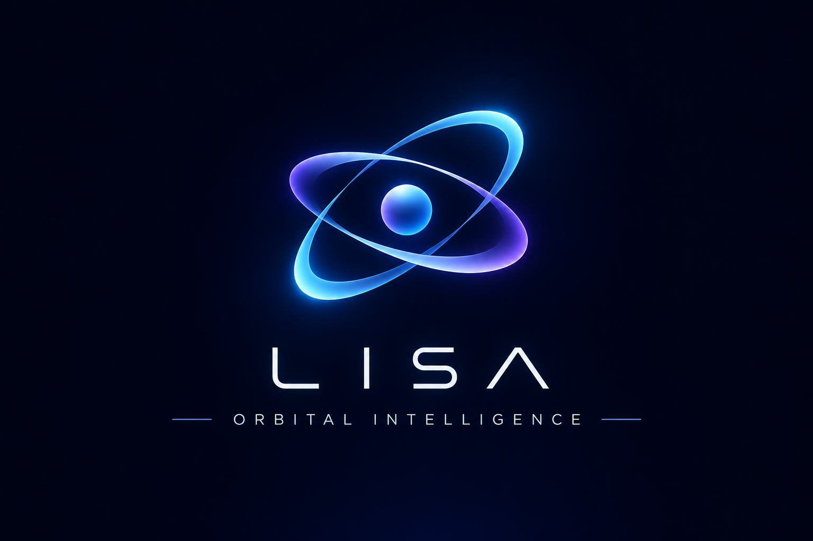

<!-- Lisa: a single-owner personal secretary. What it does, how it is built, its current verification status and where to start. -->
<p align="center">
  
</p>

<h1 align="center">Lisa</h1>

<p align="center">
  <strong>An intelligent personal secretary, built for one owner.</strong><br />
  Connecting information, commitments and ideas into a coherent daily plan.
</p>

Lisa is a single-owner personal secretary, designed to coordinate what matters without becoming another chatbot.

## What it does

- Reads the owner's forwarded mail, calendars, news and captures.
- Keeps commitments and ideas with their evidence.
- Plans each day deterministically and composes readable and spoken briefs.
- Reminds the owner on every paired iPhone, iPad and Mac.
- Emails or calls only approved destinations, under explicit rules.

`specs/R1.md` defines the requirements, `plans/R1.md` the implementation plan, and `CONSTRICTION.md` the rules for working on this repository.

## How it is built

- **A portable Swift package.** The engine, adapters, host runtime, API and command-line interface are a Swift package (Swift 6.4.2, Swift 6 language mode). It builds and is tested on Linux. It is written to build on macOS too, but no macOS build has been run yet.
- **Apple apps.** The iPhone, iPad and Mac apps live in `Apps/`, outside the package graph, and reach the engine only through the versioned API.
- **The authoritative host.** One host owns the data: the Mac app's embedded runtime, or the headless `lisa` executable. Everything is stored locally in SQLite.
- **Dry run by default.** Delivery is a dry run until the owner deliberately enables a live channel.

`docs/ARCHITECTURE.md` describes the components, and `docs/DECISIONS.md` records each design decision.

## Quick start (Linux)

```sh
swift build
swift run lisa demo --data-dir /tmp/lisa-demo
```

The demo needs no accounts and no network. It uses synthetic, labeled data and sends nothing. Setup details are in `docs/SETUP-LINUX.md`.

## Documentation

| Document | Contents |
|---|---|
| `docs/SETUP-LINUX.md` | Toolchain, system libraries, builds, tests, demo, configuration, headless operation |
| `docs/OPERATIONS.md` | The single-writer host, cycles, recovery, dry runs, retention, backups, logs, limits |
| `docs/SECURITY.md` | Secrets, authorization, untrusted content, network boundaries, what each provider receives |
| `docs/API.md` | The version 1 API: authentication, request identities, errors, pagination, routes, push payload |
| `docs/ARCHITECTURE.md` | Modules, boundaries and their implementation status |
| `docs/INTEGRATIONS.md` | Each provider: setup, limits, failure classes and what was verified |
| `docs/SETUP-APPLE.md` | Xcode build, signing, devices, push notifications, Siri and the alarm automation |
| `docs/DECISIONS.md` | Design decisions with their reasons |
| `docs/REQUIREMENTS-MATRIX.md` | Each requirement's implementation, evidence and verification status |
| `config.example.json5` | A complete, commented configuration with safe defaults |
| `IMPLEMENTATION-REPORT.md` | What R1 delivers, how it was verified, its known limitations and the owner's next steps |

## Status

The R1 package is implemented and verified on Linux; the Apple applications are written but not yet built. `IMPLEMENTATION-REPORT.md` summarizes what was verified, and `docs/REQUIREMENTS-MATRIX.md` records the evidence for each requirement and on which platform it was gathered.

- **Linux handoff.** The persistent suite in `Tests/LisaTests/` (376 tests) passes every Linux acceptance test, L01 to L33, in debug and release, offline and with synthetic data only.
- **Not yet verified, so not release-verified:**
  - The Apple applications have been written and syntax-checked on Linux, but not compiled or tested on a Mac or on devices.
  - Live integrations are checked only with the owner's credentials: mail, calendar subscriptions and feeds, Apple's push service, Twilio, X, Discord and model endpoints. None has been contacted.