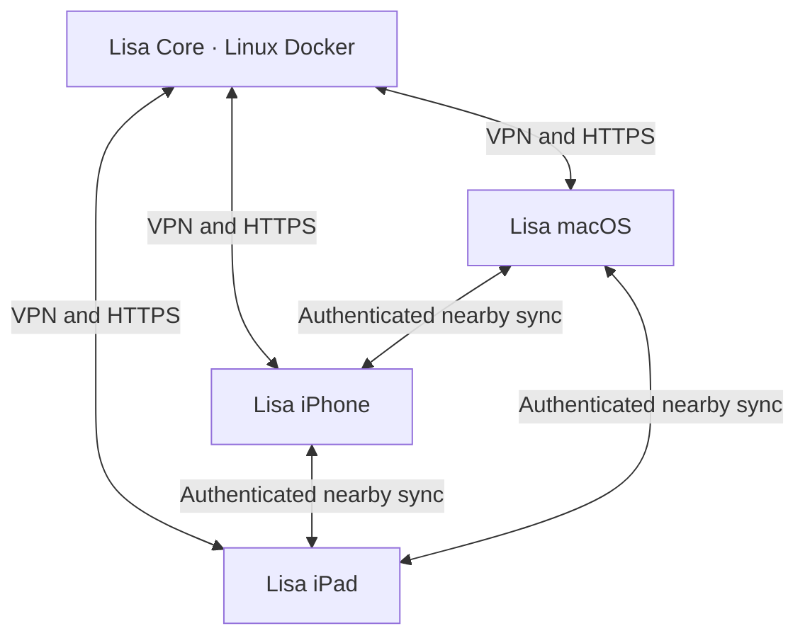

**Release:** R2  
**Specification date:** 2026-11-16  
**Primary implementation environment:** Claude Code in the existing Linux development environment  
**Primary operational host:** Lisa Core, running in Docker on a Linux server  
**Client platforms:** macOS, iOS, and iPadOS  
**Implementation language:** Swift  
**Relationship to R1:** Additive requirements, with the explicit replacements identified below

## 1. Instructions to the implementing agent

### R2-GOV-01 — Implement against the actual repository

Implement R2 according to this specification and the repository’s applicable instructions.

Before changing implementation files:

1. Read the current `AGENTS.md`, , `specs/R1.md`, this document, and relevant architecture and implementation reports.
2. Inspect the current implementation and its dependency-resolution records.
3. Record the current branch, commit, toolchain, available tools, and existing worktree changes.
4. Identify which R1 capabilities exist, which remain incomplete, and which R2 requirements replace earlier behavior.
5. Produce a concise requirement-to-component implementation plan.

The R1 implementation was still developing when this specification was authored. Do not assume a particular phase, module list, database schema, or test result is current merely because an earlier plan described it.

Use the actual repository as the implementation baseline. Do not recreate functioning R1 components unnecessarily.

A missing R1 capability needed by R2 must be identified and addressed within authorized work, or reported as a concrete blocker. It must not disappear from the release requirements.

### R2-GOV-02 — Governing instructions and authorization

Repository instructions and explicit owner instructions continue to apply.

This specification does not independently authorize:

- Branch creation or switching.
- Remote Git operations.
- Changes to development constraints.
- New dependencies, toolchains, SDKs, or development environments where approval is required.
- Access to live personal accounts.
- Real notifications, emails, calls, or paid inference during development.
- Deployment to the owner’s server.
- Resuming a workflow the owner explicitly paused.

Honor permissions already granted for the applicable scope. Do not repeatedly request the same permission.

Resolve routine implementation details independently. Continue authorized work without inserting discretionary approval gates after every milestone.

When a restriction blocks one operation, report that operation and continue independent authorized work where possible.

### R2-GOV-03 — Requirements and design defaults

`MUST` and `MUST NOT` are mandatory. `SHOULD` permits a documented exception with a concrete reason. `MAY` identifies optional work.

The owner-established R2 requirements are:

- Lisa Core runs in Docker on a Linux server.
- Lisa macOS, Lisa iPhone, and Lisa iPad primarily rely on Core.
- Clients synchronize with Core through a VPN.
- Clients retain basic functionality and intelligence without Internet access.
- Clients provide greater functionality and intelligence when Internet access works but Core is unreachable.
- Nearby Apple devices synchronize with each other, including without Internet access.

The specific protocols, merge rules, capability definitions, limits, and recovery policies below are **R2 design defaults selected by this specification**. They are not claims that the owner previously supplied those details.

Implement these defaults unless they conflict with governing instructions or verified platform capabilities. Record necessary deviations and their consequences; do not silently reduce required behavior.

### R2-GOV-04 — Verification language

Use these statuses consistently:

| Status | Meaning |
|---|---|
| `PASS` | Executed successfully, with evidence |
| `FAIL` | Executed and failed |
| `NOT_RUN_ENVIRONMENT` | Required platform, runtime, hardware, or tool is unavailable |
| `NOT_RUN_CREDENTIALS` | Live verification requires credentials or authorized account access |
| `BLOCKED_PERMISSION` | A required operation lacks authorization |
| `OUT_OF_SCOPE` | Explicitly excluded by this specification |

Distinguish implemented, compiled, executed, tested, and verified.

A Linux syntax check does not verify Apple framework availability, linking, signing, UI behavior, nearby networking, notifications, or Siri.

A simulated network transport does not verify Apple peer-to-peer connectivity.

## 2. Product purpose and relationship to R1

### R2-SCOPE-01 — Product continuity

Lisa remains a personal secretary for one owner.

R2 preserves the secretary workflow:

- Receive selected information through Lisa’s dedicated mailbox and other authorized sources.
- Read subscribed calendars.
- Preserve ideas and explicit preferences.
- Track commitments and unresolved event proposals.
- Build a daily rundown.
- Prepare grounded readable and spoken briefs.
- Remind, notify, email, and call the owner within configured permissions.
- Expose the workflow through native Apple applications and Siri.

The daily experience must remain centered on commitments, ideas, planning, and follow-up.

### R2-SCOPE-02 — Inherited boundaries

All R1 functional and security requirements remain applicable unless explicitly replaced here.

In particular:

- Lisa does not obtain access to the owner’s personal mailbox.
- Calendar subscriptions remain read-only.
- Calendar additions remain owner actions, supported by proposals and exports.
- Lisa does not send messages or calls to third parties.
- Source content and model output cannot change permissions.
- Apple News access remains through supported, authorized input paths.
- Discord access must not use a self-bot.
- Production functionality must not be replaced with permanent mocks.
- External delivery remains disabled or dry-run until configured and enabled.

### R2-SCOPE-03 — Explicit R1 replacements

| R1 behavior or assumption | R2 replacement |
|---|---|
| A Mac is the normal authoritative host | Linux-hosted Lisa Core is the normal authoritative service |
| The Mac may automatically embed the operational host | The normal Mac application is a client with local capabilities; it must not silently start a competing Core |
| Companion storage is primarily a bounded cache | Every client has a durable local store, pending-operation journal, and bounded replicated working set |
| Clients principally queue mutations while disconnected | Clients apply supported local changes immediately and reconcile them later |
| Synchronization occurs only between client and host | Core synchronization and authenticated nearby-device synchronization are required |
| Cloud/server synchronization is excluded | Synchronization with the owner’s private Core through VPN is required |
| Only the authoritative host schedules notifications | Core owns canonical notification decisions; devices may execute delegated schedules and limited locally originated reminders |
| No client-side model access is necessary | Explicitly enabled direct client inference is required for the Internet-assisted mode |
| The host’s lifecycle depends on a Mac remaining awake | Core runs independently; client suspension still limits client work |
| A new persistent `Tests/` suite is an unconditional deliverable | Follow the current ; temporary acceptance harnesses are sufficient unless a persistent suite is separately authorized |

R1 production adapters remain required. Moving responsibilities to Core does not remove them.

### R2-SCOPE-04 — Exclusions

R2 does not require:

- Multiple concurrently authoritative Core servers.
- Automatic Core leader election or server failover.
- A public Internet-facing Lisa API.
- A custom VPN implementation.
- iCloud or CloudKit synchronization.
- An Apple Watch, CarPlay, Android, or browser client.
- General-purpose device-to-device Internet routing.
- Peer access to another device’s credentials.
- Autonomous shell, browser, or filesystem agents.
- Model training or mandatory local language-model weights.
- Uninterrupted background execution on iPhone or iPad.
- Guaranteed synchronization while every nearby application is suspended.
- Exactly-once external notification, email, or call delivery.
- Automatic installation of Shortcuts personal automations.
- NFC, UWB, or raw Bluetooth as mandatory synchronization transports.

“Nearby synchronization” refers to supported Apple networking capabilities. It does not require literal NFC communication.

## 3. System architecture

### R2-ARCH-01 — Required topology

The diagram identifies supported communication relationships. It does not require every peer connection to remain open simultaneously.

### R2-ARCH-02 — Responsibility allocation

| Responsibility | Core | Apple clients |
|---|---|---|
| Canonical merged owner state | Owns | Maintain replicas and provisional changes |
| Dedicated mailbox and private source connectors | Runs | Read synchronized results |
| Canonical connector cursors | Owns | Must not advance them |
| Canonical daily plan and brief | Produces | Read, request, and produce labeled local alternatives |
| Global reminder and escalation policy | Enforces | Enforce permitted local subset |
| SMTP, telephony, APNs provider credentials | Holds | Must not receive them |
| Email and phone-call delivery | Executes | Never independently executes |
| APNs submission | Executes | Registers device and handles presentation/actions |
| Delegated local notifications | Assigns and tracks | Schedules and reconciles |
| Offline capture and editing | Receives later | Executes locally |
| Nearby replication | Accepts relayed operations | Exchanges authenticated state |
| Direct fallback inference | May define common settings | Executes only when explicitly configured |
| Device enrollment and revocation authority | Owns | Consume signed trust information |
| Owner interface and Siri | Provides services | Implements native interaction |

### R2-ARCH-03 — Shared logic and platform separation

Reuse portable Swift components for:

- Domain validation and state transitions.
- Time semantics.
- Merge rules.
- Planning constraints.
- Structured brief composition.
- Model-output validation.
- Synchronization messages and receipts.
- Notification policy calculations.
- Resource limits.

Isolate:

- Apple networking, Keychain, notifications, App Intents, and UI.
- Core server networking and lifecycle.
- Core-only connectors and delivery providers.
- Persistence implementations and migrations.

Clients may use portable domain and planning logic without linking Core-only networking libraries or adapters.

Do not make Python, Node.js, Claude Code, or another developer-agent CLI a production dependency.

### R2-ARCH-04 — Non-negotiable invariants

The implementation must preserve these invariants:

1. A reported successful local save is durable.
2. Transport retries do not create new logical operations.
3. A peer receipt is not a Core commitment.
4. Concurrent owner edits are not silently discarded.
5. Wall-clock timestamps do not determine edit authority.
6. Models do not overwrite explicit owner corrections.
7. A stale device cannot silently resurrect deleted data.
8. A reconnecting device does not become another global scheduler.
9. Core-only credentials never enter ordinary replicated data.
10. Nearby discovery does not imply trust.
11. Loss of connectivity does not discard pending changes.
12. One unavailable service does not disable unrelated local functions.

## 4. Capability modes

### R2-CAP-01 — Independent capability assessment

Track capabilities independently, including:

- Authenticated Core reachability.
- Core API and sync compatibility.
- Individual fallback-provider reachability.
- Nearby networking availability.
- Local data availability and freshness.
- Notification authorization and schedule coverage.
- Device enrollment and revocation state.
- Model availability.
- Storage and resource health.

Do not infer Core availability merely from a network-path indicator or VPN status.

A reachable Core with a failed model provider still provides synchronization and other working services.

A reachable Internet connection with no configured fallback provider must not be presented as working cloud intelligence.

### R2-CAP-02 — Required mode matrix

| Capability | Core-assisted | Internet-assisted, Core unavailable | Fully offline |
|---|---|---|---|
| Read locally available tasks, ideas, preferences, brief, and rundown | Required | Required | Required |
| Capture text, links, ideas, and tasks | Required | Required | Required |
| Edit supported owner data | Required | Required | Required |
| Search the replicated working set | Required | Required | Required |
| Deterministic local planning | Required as fallback | Required | Required |
| Structured local brief | Required as fallback | Required | Required |
| Core inference and canonical regeneration | Available when healthy | Unavailable | Unavailable |
| Direct configured provider inference | Optional fallback | Required implementation | Unavailable |
| Explicit public feed or URL retrieval | Through configured paths | Required supported subset | Unavailable |
| Core private source refresh | Required when configured | No client takeover | Unavailable |
| Core email and call delivery | Core policy | No client takeover | Unavailable |
| Previously scheduled local notifications | Required | Required | Required |
| New local reminders within permitted scope | Required | Required | Required |
| Nearby synchronization | When available | When available | When available |
| Canonical reconciliation | Directly or through operation relay | Through a connected peer, if available | Deferred until a path exists |

Actual availability must follow the relevant capability, not a hard-coded global mode switch.

### R2-CAP-03 — Minimum offline intelligence

Every supported Apple client must provide useful behavior without Core, Internet access, or a language model:

- Search captured ideas, tasks, preferences, and cached evidence.
- Sort commitments by deadline, priority, and state.
- Detect overdue confirmed tasks.
- Recompute a provisional daily plan using available calendar data and R1 constraints.
- Identify unscheduled work and explain deterministic scheduling conflicts.
- Produce a structured brief from locally available records.
- Apply explicit preference changes within the permitted replicated preference set.
- Create and manage explicitly entered tasks and reminders.
- Preserve unstructured captures for later interpretation.

The baseline may use deterministic algorithms. It must not depend on Apple Intelligence availability or a large model download.

Unsupported free-form interpretation must remain pending or request clarification. It must not fabricate extraction results.

### R2-CAP-04 — Transitions

Connectivity changes must not:

- Interrupt a durable capture.
- Replace a user-edited draft.
- Clear the local database.
- Reissue a completed inference request automatically.
- Replay expired delivery jobs.
- Reset a retry counter indefinitely.
- Promote a provisional plan without reconciliation.

Persist work before changing execution paths.

Use cancellation, bounded timeouts, exponential backoff with jitter, and explicit manual retry.

Authentication failure, revocation, and incompatible protocol versions must not cause an endless reconnect loop or an insecure fallback.

## 5. Local data and replicated working set

### R2-DATA-01 — Durable client storage

Each client installation must maintain a separate local database.

Use SQLite or the repository’s already approved equivalent if it satisfies all required transaction and recovery behavior.

Persist:

- Canonical replicated records and revisions.
- Original local captures.
- Pending local and relayed operations.
- Core decisions and receipts.
- Peer replication progress.
- Conflicts and their candidates.
- Local derived plans and briefs.
- Notification assignments and local scheduling results.
- Tombstones and deduplication metadata.
- Source freshness.
- Device-local settings and non-secret provider metadata.

Do not synchronize SQLite files, WAL files, or entire database directories between devices.

### R2-DATA-02 — Atomic local mutation

A supported local mutation must atomically:

1. Validate the command.
2. Allocate its stable operation identity.
3. Persist its original payload.
4. Update the local effective view.
5. Record the operation for synchronization.
6. Record required local follow-up work.

Only then may the application report success.

A crash after local success must not lose the change.

A storage failure must produce a truthful error. Do not show “saved” for a change held only in memory.

### R2-DATA-03 — Working-set defaults

The initial replicated working set must include:

| Data | Default |
|---|---|
| Active tasks and unresolved event proposals | All, subject to explicit storage-capacity handling |
| Unarchived ideas | All |
| Explicit non-secret owner preferences | All permitted fields |
| Calendar occurrences | Previous 30 days and next 90 days |
| Daily briefs | Most recent 30 days |
| Plans | Current planning window and recent history needed for continuity |
| Evidence | Bounded excerpts and references needed to explain working-set items |
| Pending operations and unresolved conflicts | Never automatically evicted |
| Large attachments and unsupported documents | Not automatically replicated |
| Credentials and private connector configuration | Excluded |

The working set may be configurable.

A filtered or incomplete replica must remain visibly incomplete. Absence from a client’s working set must not be interpreted as deletion.

Eviction removes cached material, not owner records or unsynchronized edits.

### R2-DATA-04 — Provenance and freshness

Every generated or imported item must retain:

- Originating source or capture.
- Originating device where applicable.
- Relevant source timestamps.
- Last successful retrieval or synchronization.
- Source and input revisions.
- Interpretation status.
- Whether the result is canonical, locally generated, or provisional.

Synchronizing an old calendar snapshot does not make its source fresh.

A peer’s recent contact with Core does not prove every connector has refreshed.

### R2-DATA-05 — Time and preferences

Preserve R1 time semantics.

Separate:

- The owner’s planning timezone.
- Source timezone semantics.
- The device’s current timezone.
- UTC synchronization and audit instants.

A device timezone change must not silently overwrite the owner’s planning timezone.

Use monotonic time for in-process timeout and backoff calculations. Preserve UTC and local-date meaning for domain data.

Support daylight-saving transitions, date-only deadlines, and clock changes without using clock order as conflict resolution.

## 6. Synchronization protocol

### R2-SYNC-01 — One operation model across transports

Core HTTP synchronization and nearby synchronization must carry the same logical operation identities and semantics.

Use semantic operations such as:

- Create capture.
- Edit idea field.
- Complete task.
- Reopen task.
- Acknowledge reminder occurrence.
- Snooze reminder occurrence.
- Set a permitted preference.
- Delete an owner item.
- Resolve a conflict.

Do not synchronize unrestricted SQL statements or arbitrary database patches.

Each operation must contain at least:

| Field | Purpose |
|---|---|
| Protocol and schema version | Compatibility |
| Owner/dataset identifier | Prevent cross-dataset application |
| Origin device identifier | Attribution |
| Installation incarnation | Distinguish reinstallations or restored installations |
| Origin sequence number | Detect gaps and replay |
| Stable operation identifier | Idempotency |
| Entity identifier and type | Target |
| Operation type and payload | Meaning |
| Causal dependencies and observed field versions | Detect concurrent changes |
| Relevant policy version | Validate authorization assumptions |
| Creation timestamp | Display and audit only |
| Payload digest | Detect identity reuse with different content |
| Origin signature | Authenticate relayed operations |

Sign an unambiguous, versioned byte representation. Relays must preserve the signed bytes.

Document encoding, signature input, duplicate-key handling, unknown-field handling, and bounds. Include protocol test vectors.

### R2-SYNC-02 — Idempotency and ordering

The same logical action retains the same operation identifier across:

- HTTP retries.
- Peer transfers.
- Application restarts.
- Core restarts.
- Multiple relay paths.

Receiving the same identifier and payload again must return its existing outcome.

Receiving the same identifier with different content must fail and produce a security diagnostic.

Origin sequence numbers and causal dependencies must not be treated as proof that missing earlier operations have arrived.

Out-of-order operations may wait for dependencies. They must not be silently skipped.

Rejected dependencies must produce a visible dependent-operation outcome; they must not leave descendants waiting forever.

### R2-SYNC-03 — Core application and receipts

Core must atomically persist:

- The operation’s accepted or rejected decision.
- Its effect on canonical state, where applicable.
- Resulting conflicts.
- The canonical change-log entry.
- Required outbox updates.
- Its idempotency record.

Only after commitment may Core issue a committed receipt.

Receipts must identify the dataset, recovery epoch, operation, digest, outcome, and canonical commit position.

Core receipts and replicated canonical batches must be verifiable when forwarded through another device.

Required outcomes:

| Outcome | Meaning |
|---|---|
| `accepted` | Applied to canonical state |
| `accepted_with_conflict` | Durably retained as a conflict candidate |
| `duplicate` | Previously processed; original outcome included |
| `waiting_for_dependencies` | Required causal context is missing |
| `rejected` | Not applied; reason and recovery path provided |

A network response lost after commitment must be recoverable through idempotent resubmission or receipt lookup.

### R2-SYNC-04 — Client synchronization states

Clients must distinguish at least:

- Saved locally.
- Copied to another device.
- Submitted to Core.
- Committed by Core.
- Committed with a conflict.
- Rejected.
- Waiting for dependencies.
- Requiring owner review.

“Copied to another device” must never be displayed as “synced with Core.”

A peer copy does not authorize the originating device to discard an operation that Core has not committed.

### R2-SYNC-05 — Anti-entropy and snapshots

Implement bounded incremental synchronization using:

- Core change-log cursors.
- Per-origin sequence tracking with explicit gap handling.
- Operation and receipt exchange.
- Snapshot recovery when a cursor is unavailable or incompatible.

A snapshot must have:

- Dataset and recovery-epoch identity.
- A consistent canonical cut.
- Schema and protocol versions.
- Integrity-checked chunks.
- Record and tombstone coverage.
- The causal summary needed to interpret later operations.

Install snapshots through staging and an atomic replacement of the canonical local view.

Preserve pending operations, original captures, local conflicts, and unresolved receipts across snapshot replacement.

Do not overwrite a live local database with downloaded bytes.

### R2-SYNC-06 — Conflict rules

Use causal relationships to distinguish sequential edits from concurrent edits.

The following rules are mandatory:

| Situation | Required behavior |
|---|---|
| Duplicate operation | Apply once |
| Changes to different independent fields | Merge both |
| Concurrent incompatible edits to the same scalar field | Preserve both candidates and surface a conflict |
| Explicit owner correction versus model suggestion | Owner correction remains effective |
| Concurrent note additions | Preserve both notes |
| Concurrent tag additions/removals | Use observed-remove semantics or an equivalent documented rule that preserves unseen concurrent additions |
| Task completion versus ordinary field editing | Preserve the edit; task remains complete |
| Task cancellation versus ordinary editing | Preserve relevant history; cancellation remains effective |
| Concurrent completion and cancellation | Both remain recorded; effective state is terminal and delivery is suppressed |
| Reopening a terminal task | Requires an explicit operation referencing the terminal state being reopened |
| Reopening concurrent with an unseen terminal action | Terminal state remains effective until explicitly resolved |
| Reminder acknowledgement or dismissal versus concurrent snooze | Acknowledgement/dismissal suppresses that occurrence |
| Concurrent snoozes | Use the later permitted snooze instant, bounded by policy; retain both actions in history |
| Item deletion versus stale or concurrent edits | Deletion wins; retain recoverable edit information where retention permits |
| Concurrent generated plans or briefs | Preserve separate derived artifacts; do not merge their text as owner state |
| Conflict in a consequential planning field | Mark uncertainty and suppress escalation based on the unresolved value |

Do not implement blanket last-writer-wins behavior for owner data.

A conflict-resolution operation must reference all candidates the owner reviewed. If another candidate arrives concurrently, preserve the new conflict rather than silently overwriting it.

Convergence must not depend on message arrival order.

### R2-SYNC-07 — Deletion, retention, and old devices

Deletion must propagate to:

- Canonical records.
- Client replicas.
- Search indexes.
- Generated caches.
- Future reminder and delivery work.
- Relevant evidence-derived outputs.

Retain minimal deletion and replay-suppression metadata without retaining unnecessary deleted content.

A stale device must not recreate a deleted item by replaying an old update.

Restoring deleted content requires an explicit owner action. The default restoration creates a new identity with provenance.

Default incremental-history retention is 90 days. A device older than the retained history must obtain a snapshot before ordinary synchronization resumes.

Retain compact operation identity/digest/outcome metadata and deletion tombstones for the live dataset unless a documented compaction scheme preserves equivalent replay and deletion guarantees.

Storage limits must cause visible backpressure or maintenance requirements, not silent loss of those guarantees.

### R2-SYNC-08 — Reconciliation sequence

On reconnection:

1. Authenticate and negotiate compatibility.
2. Obtain current trust, revocation, policy, and recovery-epoch information.
3. Stop using newly invalid authority.
4. Recover the canonical baseline or snapshot.
5. Submit eligible pending operations in dependency order.
6. Obtain committed outcomes.
7. Rebuild the effective local view from canonical state plus remaining provisional operations.
8. Surface conflicts and rejected changes.
9. Recompute affected plans, briefs, and local notification schedules.
10. Resume ordinary incremental synchronization.

Do not discard the local view before pending changes are safely preserved.

## 7. Nearby Apple-device synchronization

### R2-NEAR-01 — Production transport

Implement nearby networking with Apple’s Network framework, using Bonjour discovery and peer-to-peer connectivity where supported.

Use APIs compatible with the project’s deployment targets. The older `NWConnection`, `NWListener`, and `NWBrowser` APIs are acceptable; adopting newer APIs must not silently raise minimum OS requirements.

Enable peer-to-peer networking explicitly where required. Apple documents Network framework support for this and currently directs new work away from Multipeer Connectivity. [S1][S2]

Keep the Apple transport behind a portable synchronization interface.

### R2-NEAR-02 — Required operation without Internet

Already enrolled, authorized devices must exchange supported changes:

- On the same local network without Internet access.
- Through supported Apple peer-to-peer networking without a configured shared access point.
- While Core is unreachable.
- After interrupted transfers and application restarts.

Physical-device testing must establish the supported combinations.

Disabling a needed radio or denying local-network access must produce a visible unavailable state. Lisa must not pretend nearby synchronization is active.

### R2-NEAR-03 — Discovery and session lifecycle

Discovery must:

- Advertise only the Lisa service.
- Avoid broadcasting owner names, personal content, credentials, or stable account identifiers.
- Use bounded discovery and connection attempts.
- Avoid continuous high-power scanning.
- Handle simultaneous connection attempts without duplicate logical sessions.
- Reconnect without creating duplicate operations.

Default behavior is foreground discovery when nearby synchronization is enabled, with immediate synchronization on an established authenticated connection.

Provide a manual “Sync nearby devices” action.

Stop unnecessary browsing after establishing useful connections, and close idle sessions.

### R2-NEAR-04 — Background limitations

Persist work before suspension and use legitimate, bounded background execution opportunities.

Do not promise continuous peer discovery or synchronization while iOS or iPadOS applications are suspended or terminated. Apple controls the scheduling and duration of background work. [S4]

The UI and documentation must distinguish:

- Nearby synchronization available now.
- Pending synchronization requiring an active application.
- Background work requested but not yet granted.
- Permission or radio unavailable.

Do not misuse audio, location, VoIP, or other background modes to keep Lisa running.

### R2-NEAR-05 — Store-and-forward relay

An enrolled peer may:

- Store another enrolled device’s signed operations.
- Forward them to Core using its own authenticated connection.
- Return Core-signed receipts.
- Share verified canonical updates and snapshots within the owner’s authorized dataset.

Core must verify the originating device and operation independently of the relay.

A relay must not:

- Rewrite the operation’s identity or authorship.
- Impersonate the origin.
- Return an invented Core receipt.
- Share its Core credential.
- Expose a general HTTP proxy.
- Forward arbitrary URLs or commands.

Direct Core synchronization and relay synchronization may run concurrently. Idempotency must make duplicate paths harmless.

A recent relayed update does not imply a persistent live connection to Core.

## 8. Identity, trust, and permissions

### R2-TRUST-01 — Enrollment

Each installation must have:

- A unique device identity.
- A distinct installation incarnation.
- A device signing identity.
- A revocable Core credential.
- A protected local trust anchor for the owner’s dataset.
- A Core-issued authorization record binding identity, keys, and permitted capabilities.

Initial enrollment requires an authenticated Core path and an owner-controlled, single-use pairing procedure.

Pairing information must bind the intended Core identity. A short code alone must not permit an untrusted endpoint to substitute itself.

New device enrollment while Core is unavailable is outside the baseline. Already enrolled devices continue local and nearby operation within their authorization validity.

### R2-TRUST-02 — Secure transport

Core connections require HTTPS and application authentication even over VPN.

Nearby sessions require encrypted transport and mutual authentication against enrolled device identities.

Use supported TLS and approved cryptographic implementations. Do not implement custom encryption primitives.

Pinning or private certificate authorities are acceptable when explicitly configured. Never accept all certificates or disable hostname/certificate validation globally.

Possession of a Bonjour service name, nearby radio signal, or APNs token does not authenticate a device.

### R2-TRUST-03 — Trust distribution and revocation

Core must maintain a signed, versioned device roster and revocation state.

Devices must:

- Retain the newest verified trust version.
- Refuse trust rollback.
- Exchange verified updates through nearby synchronization.
- Reject peers known to be revoked.
- Stop forwarding or applying newly unauthorized operations.
- Preserve rejected local work for inspection or export where appropriate.

Core must reject newly submitted operations from a currently revoked origin, even if their untrusted creation timestamps claim they were created earlier.

Previously committed legitimate data remains committed unless separately removed.

Immediate revocation cannot be enforced on devices that have received no revocation information. Document this limitation.

Default maximum age for initiating a nearby data-exchange session using cached trust information is 30 days. Expiration disables new peer exchanges, not local reading or capture. The limit must be configurable.

### R2-TRUST-04 — Secret boundaries

Core-only secrets include:

- Mailbox credentials.
- Private calendar subscription secrets.
- SMTP credentials.
- Telephony credentials.
- APNs provider signing keys.
- Core model-provider credentials.
- Administrative credentials.

They must not appear in replicated records, nearby messages, ordinary exports, or logs.

Apple device secrets must use Keychain with appropriate access controls.

Direct fallback-model credentials are separately configured device-local secrets. They are not copied from Core or synchronized between devices.

Document key rotation, reinstall behavior, and lost-device handling.

### R2-TRUST-05 — Administrative authority

Ordinary synchronized operations may change owner data and permitted non-secret preferences.

They must not change:

- Approved email recipients or phone destinations.
- Global call or email enablement.
- Core connector credentials.
- Global device trust.
- Core TLS identity.
- Global data-sharing authorization.
- Global security policy.

Preserve the R1 administrative boundary for those settings.

Device-local settings may independently:

- Disable that device’s notifications or nearby networking.
- Control local display preferences.
- Configure explicitly authorized direct fallback inference.
- Reduce local data-sharing or resource use.

A client must clearly distinguish a local setting from a global setting.

## 9. Internet-assisted intelligence

### R2-INT-01 — Required fallback provider

Deliver a production client-side adapter for the supported OpenAI-compatible Chat Completions subset already used by Lisa, implemented through an Apple-compatible networking path.

The provider configuration must include:

- Endpoint.
- Model identifier.
- Device-local credential reference.
- Explicit data-sharing enablement.
- Request timeout.
- Input/output bounds.
- Request budget.
- Availability and failure status.

No provider is enabled by default.

A configured Core provider does not automatically authorize a client to send the same data elsewhere.

### R2-INT-02 — Required fallback workflows

When Core is unavailable and an authorized provider is reachable, the client must support:

- Interpreting newly captured text into proposed tasks, ideas, or event proposals.
- Summarizing selected locally available evidence.
- Preparing an improved local brief.
- Explaining a provisional local plan.
- Answering bounded questions grounded in the available local working set.

The client must disclose that the result uses local data and identify material missing or stale sources.

Generated actions remain subject to the same deterministic validation and permission boundaries as Core-generated suggestions.

### R2-INT-03 — Public retrieval subset

Support foreground, explicitly requested retrieval of:

- Owner-configured public RSS/Atom feeds.
- Owner-supplied supported public URLs.

Retain R1 URL, redirect, size, parser, and network-safety controls.

Do not automatically follow links merely because a source or model mentioned them.

Clients must not take over Core’s private mailbox, private calendar, X, or Discord connectors by copying credentials.

Client-fetched content must carry provenance. It must not advance canonical connector cursors or treat a partial client fetch as a complete canonical refresh.

### R2-INT-04 — Request identity and recovery

Persist each inference request’s:

- Stable request identity.
- Input references and revisions.
- Provider/model identity.
- Prompt/template version.
- Status.
- Validated result.
- Known or estimated usage.

Deduplicate requests generated by repeated UI actions and connectivity transitions where their logical intent is the same.

A timeout after submission may have incurred provider usage. Do not blindly resubmit an uncertain request.

On Core reconnection, synchronize valid proposals and evidence. Do not automatically regenerate every result merely because Core is reachable again.

A result based on obsolete or deleted evidence must be invalidated or revalidated before application.

### R2-INT-05 — Budgets and optional local models

Defaults:

- One model request in flight per device.
- Ten fallback requests per device per day.
- At most one structured-output repair attempt, counted against the budget.
- Bounded context selected from relevant evidence.
- No automatic background inference loop.

Persist budget accounting across restarts.

Per-device limits are not a guaranteed global monetary limit while devices are partitioned. Do not claim otherwise. A hard global spending ceiling requires provider enforcement or preallocated budgets.

Local language models may be added behind the same provider interface, but are optional and must not be required for the offline baseline.

## 10. Planning, briefs, memory, and owner actions

### R2-WORK-01 — Local planning

Clients must reuse R1 deterministic planning rules.

A local plan must record:

- The canonical checkpoint used.
- Included provisional operations.
- Calendar coverage and freshness.
- Unresolved conflicts.
- Algorithm version.
- Local generation time.

Display it as provisional until its relevant owner actions are accepted by Core and canonical planning is reconciled.

Do not present stale calendar gaps as confidently free.

Locked or explicitly accepted owner blocks must be preserved as owner intent. Concurrent incompatible changes must surface rather than being silently rescheduled.

### R2-WORK-02 — Brief identity

Core retains the canonical daily brief identity per local date and planning timezone.

Local briefs have distinct identities containing their originating device and input version.

A local brief must not overwrite a canonical brief merely because it was generated later.

The application must provide a useful current view while distinguishing:

- Latest canonical brief.
- Locally generated brief.
- Age and missing sources.
- Regeneration failure.

Readable and spoken versions must convey the same material uncertainty.

### R2-WORK-03 — Memory

Explicit owner preferences must synchronize according to the conflict rules.

Inferred preferences remain proposals until accepted where R1 requires confirmation.

Reprocessing evidence on Core or another device must not erase explicit corrections.

Original ideas and captures remain distinct from generated summaries.

### R2-WORK-04 — Offline action semantics

Supported offline actions include:

- Capture and edit an idea.
- Create and edit a task.
- Complete a task.
- Acknowledge, dismiss, or snooze a reminder.
- Review or dismiss an event proposal.
- Change permitted non-secret preferences.
- Accept or adjust a local planning proposal.
- Delete supported owner items.

Show the local result immediately after durable commitment, together with pending synchronization where relevant.

An offline acknowledgement cannot suppress a Core action before Core learns of it. Documentation and UI must not imply instantaneous global suppression across a partition.

## 11. Notifications and external delivery

### R2-NOT-01 — Canonical policy and default routing

Core remains responsible for canonical reminder eligibility, escalation, and global delivery policy.

Canonical notifications must target every enabled paired device by default, including both iPhone and iPad.

Delivery to several devices is intentional fan-out. It is distinct from accidental repeat delivery to the same device.

Retain:

- Per-device preferences.
- Generic notification text by default.
- Permission reporting.
- Quiet hours.
- Owner-only destinations.
- Expiry and stale-item suppression.
- Separate provider acceptance, app receipt, and owner acknowledgement.

### R2-NOT-02 — Local notification schedules

Support advance scheduling of local notifications so a device can receive known reminders without a live Core connection.

Default local scheduling horizon is 48 hours, with at most 32 pending Lisa notification requests per device. These are application limits, not claims about the operating system’s maximum.

Prioritize confirmed, time-sensitive reminders. Display the end of local schedule coverage.

Apple’s notification system can present a scheduled local notification when the application is not running. This does not provide general background execution. [S5]

### R2-NOT-03 — Per-device delivery ownership

For each logical reminder occurrence and target device, persist a delivery-ownership record.

At minimum it must distinguish:

- Core-owned.
- Reserved for local scheduling.
- Local scheduling confirmed.
- Scheduling failed.
- Suppressed or cancelled.
- Expired.
- Outcome unknown.

Use a stable occurrence identity and monotonically advancing assignment generation. A content revision alone must not create a new reminder occurrence.

Required handoff behavior:

1. Core durably reserves the occurrence for the target device and suppresses Core submission for that slot.
2. The device receives a verifiable assignment.
3. The device persists the assignment and schedules the OS notification using a stable identifier.
4. The device reports the scheduling outcome.
5. Core records the outcome without treating scheduling as proof of display.

If communication fails during the handoff, preserve the uncertain state.

Core must not automatically reclaim an uncertain local assignment and send the same occurrence merely because the device is temporarily unreachable.

A return to Core ownership requires confirmed cancellation or a documented reconciliation proving the device will not execute that assignment.

If an occurrence has already expired, record it as expired rather than replaying it.

The handoff can leave a visible coverage gap after a crash or partition. Do not hide that gap or claim an impossible exactly-once guarantee.

### R2-NOT-04 — Locally originated reminders

A client may schedule a reminder for an explicit owner action created locally while Core is unavailable.

Before Core acceptance:

- The originating device owns its local delivery.
- Nearby peers may display the item and its pending status.
- They must not independently create competing delivery for that same target-device slot.

After acceptance, Core may create future delivery slots for other enabled devices while preserving the originating device’s existing ownership.

Do not replay every missed historical reminder when a local item first reaches Core.

A device may not independently take ownership of an existing Core-owned occurrence simply because it detects an outage.

### R2-NOT-05 — Reconciliation and platform behavior

On launch, foregrounding, relevant synchronization, and notification actions:

- Compare persisted assignments with pending OS notification requests.
- Restore eligible missing local requests where ownership permits.
- Cancel obsolete requests.
- Remove stale delivered notifications where the platform permits.
- Apply acknowledged, completed, cancelled, or deleted state.
- Preserve unresolved handoff outcomes.
- Report permission changes.

Do not use OS notification identifiers, APNs identifiers, or collapse identifiers as substitutes for application-level idempotency.

APNs is best effort and may delay, reorder, throttle, or omit delivery. It is not the synchronization database. [S6]

### R2-NOT-06 — Core-only email and calls

Only Core sends email or initiates phone calls.

Clients must not perform these actions during Core outages.

Core must preserve R1:

- Persisted outbox behavior.
- Transactional claiming.
- Recipient enforcement.
- Quiet hours.
- Confirmation and urgency rules.
- Rate limits.
- Unknown-outcome handling.
- Recovery without blind replay.

Missing push acknowledgement or device disconnection alone must not authorize a call.

A Core restart or restore must not blindly resend previously attempted communications.

## 12. Core deployment and operation

### R2-CORE-01 — Container deliverables

Deliver:

- A production Dockerfile.
- A documented Docker Compose deployment.
- Versioned example configuration.
- Health checks.
- Persistent-volume configuration.
- Secret-file integration.
- Backup, restore, upgrade, and rollback instructions.

Use a reproducible build and pinned, compatible toolchain/dependency versions.

Support `linux/amd64` and `linux/arm64` in build definitions. Report actual build and runtime verification separately for each architecture.

Do not claim a cross-architecture image works merely because its build command completed.

### R2-CORE-02 — Container boundaries

The production container must:

- Run as a non-root user.
- Use explicit persistent storage for state.
- Keep configuration and secrets separate from mutable application data.
- Avoid embedding secrets in image layers or build arguments.
- Avoid privileged mode and Docker socket access.
- Support a read-only root filesystem with explicit writable locations.
- Handle termination signals and graceful shutdown.
- Bound logs and temporary runtime storage.

Compose secret files may be mounted under `/run/secrets`; document host-file protection and access requirements. [S7]

### R2-CORE-03 — VPN and API exposure

The owner supplies and operates the VPN.

Lisa must not install or modify VPN software automatically.

Production API exposure must be restricted to the intended VPN path, with HTTPS and application authentication.

Provide:

- Loopback-only development defaults.
- An explicit production bind/publish address.
- No silent fallback to all interfaces if the configured VPN address is unavailable.
- IPv4 and IPv6 exposure checks.
- Firewall and routing verification instructions.
- A method to verify that a non-VPN client cannot reach the application API.

Docker publication without a specific host address can expose a port broadly. Binding and firewall behavior must be verified on the actual host. [S8]

Do not expose the API publicly merely to make notifications work.

APNs and other configured providers use outbound Core connections.

### R2-CORE-04 — Single Core ownership

Exactly one active Core runtime may write a dataset and execute its global scheduler.

Use a data-directory lock and deployment controls.

Document that a local file lock does not prevent two servers from running independent copies of the same backup.

R2 does not implement automatic cluster coordination. Migration and restore procedures must fence or stop the previous Core before activating a replacement.

### R2-CORE-05 — Health and recovery

Separate:

- Process liveness.
- Database readiness.
- Sync readiness.
- Source-specific failures.
- Model availability.
- Delivery availability.
- Storage capacity.
- Backup age.
- Device synchronization lag.

A failed news provider must not make the whole service unready.

On restart:

1. Recover transactions and pending operations.
2. Inspect uncertain external outcomes.
3. Reconcile current schedules.
4. Suppress obsolete work.
5. Resume bounded processing.
6. Expose degraded capabilities truthfully.

Do not use restart loops as a substitute for handling a persistent provider failure.

### R2-CORE-06 — Backup and recovery epochs

Provide a consistent backup procedure using SQLite-supported backup behavior or a quiesced database.

Do not copy an active database while ignoring its WAL state.

Backups must include:

- Schema/version manifest.
- Canonical records.
- Operation and receipt state.
- Tombstones.
- Delivery history and uncertain outcomes.
- Device enrollment metadata.
- Necessary non-secret configuration references.

Secret recovery must be documented separately.

An ordinary process restart preserves the dataset’s recovery epoch.

Restoring an older backup or performing recovery that can move canonical history backward must establish a new recovery epoch. Clients must detect it and reconcile through the recovery path rather than treating old cursors as current.

A restored Core must start with outbound side effects suspended until delivery state and outstanding device operations are reconciled or explicitly reviewed.

Do not claim that a backup restores changes it never contained. Document how surviving client journals can recover additional owner changes and which gaps remain.

## 13. API and protocol contract

### R2-API-01 — Versioning and compatibility

Introduce an explicit R2 API/sync version.

Negotiate:

- API version.
- Operation schema.
- Supported features.
- Dataset identity.
- Recovery epoch.
- Client compatibility.

Unknown required capabilities must fail clearly.

Document compatibility behavior for older clients.

After migration to R2 semantics, R1 clients must not perform mutations through a path that bypasses the R2 operation ledger. A clear `upgrade_required` response is acceptable.

Do not silently reinterpret an R1 mutation as an unsafe R2 operation.

### R2-API-02 — Minimum operations

Provide routes or equivalent contracts for:

| Operation | Required behavior |
|---|---|
| Capability and health query | Authenticated, redacted capability state |
| Device enrollment | Owner-controlled pairing |
| Trust and policy retrieval | Versioned, verifiable state |
| Operation submission | Bounded batches with per-operation outcomes |
| Receipt lookup | Recover lost responses |
| Incremental changes | Cursor-based canonical changes |
| Snapshot retrieval | Consistent, integrity-checked recovery |
| Replication acknowledgement | Durable checkpoint reporting |
| Conflict listing | Candidates and affected fields |
| Conflict resolution | Explicit reviewed causal context |
| Working-set queries | Coverage and freshness included |
| Notification assignment exchange | Ownership and generation preserved |
| Notification scheduling/receipt report | Distinguish scheduling, receipt, acknowledgement |
| Device revocation | Authorized administrative path |
| Owner-data export | Includes appropriate unsynchronized state |

The API may retain compatible R1 query routes.

### R2-API-03 — Errors and bounds

Use typed errors for:

- Malformed data.
- Unauthenticated access.
- Forbidden operations.
- Revoked devices.
- Expired trust.
- Wrong dataset.
- Recovery-epoch mismatch.
- Unsupported version.
- Missing dependency.
- Conflict.
- Oversized data.
- Throttling.
- Insufficient storage.
- Temporary failure.

Batch submission may partly succeed. Return outcomes per operation.

Do not advance a client checkpoint past changes it has not durably installed.

### R2-API-04 — Administrative and diagnostic interfaces

Extend the existing CLI with equivalent operations for:

- Core startup and health.
- Device enrollment and revocation.
- Sync status.
- Pending operations.
- Conflict inspection.
- Backup validation and restore.
- Migration inspection.
- Delivery suspension and recovery.
- Protocol diagnostics.

Command names are implementation choices, but documentation and actual behavior must agree.

Administrative output must redact secrets and unnecessary personal content.

## 14. Native applications and Siri

### R2-UI-01 — Required application experience

All three Apple clients must expose the relevant R1 workflows:

- Today.
- Brief.
- Inbox/review.
- Ideas.
- Memory.
- Settings and health.

The Mac must operate as a client without requiring a local Core.

The iPad must provide an appropriate adaptive layout rather than merely enlarging an iPhone screen.

Core unavailability must not replace the application with a connection-error screen.

### R2-UI-02 — Clear state presentation

Use understandable status language, including:

- Saved on this device.
- Shared with a nearby device.
- Synced with Core.
- Waiting to sync.
- Needs review.
- Using saved calendar information.
- Local brief.
- Notifications scheduled through a stated time.

Keep operation counters, hashes, protocol versions, and transport details in diagnostics.

Do not expose technical machinery in the ordinary daily workflow unless it helps the owner make a decision.

### R2-UI-03 — Conflict resolution

Provide a usable conflict view showing:

- The affected item and field.
- Each candidate value.
- Originating device.
- Relevant causal or contextual explanation.
- Whether planning or reminders are affected.
- Controls to select or edit a resolution.

Preserve the owner’s proposed resolution if a new conflict arrives while the view is open.

Do not require editing raw JSON or database records.

### R2-UI-04 — Permissions and accessibility

Handle:

- Notification authorization.
- Local-network authorization.
- Keychain access failures.
- Device enrollment loss.
- Provider configuration errors.
- Background execution limits.

Include appropriate usage descriptions and Bonjour service declarations. Test local-network privacy behavior on physical devices. [S3]

Support VoiceOver, Dynamic Type where applicable, keyboard navigation on Mac/iPad, light/dark appearance, and readable empty/error states.

### R2-UI-05 — Siri and alarm continuity

Preserve the R1 App Intents:

- Get today’s brief.
- Get today’s rundown.
- Capture an idea.
- Save supplied text or URL.
- Complete a selected task.
- Snooze a selected reminder.

Each intent must use the same durable command path as the application.

Intent responses must distinguish:

- Completed locally.
- Queued for synchronization.
- Committed by Core where known.
- Needs clarification.
- Unavailable.
- Failed.

Do not report success before local persistence.

The alarm-related workflow must use a prepared canonical or local brief when available. It must not require a live model call at alarm time.

Preserve the distinction between alarm-start, stopped, and snoozed triggers. Document and verify actual behavior on the target device.

Siri speech recognition and locked-device execution may depend on platform conditions. Offline domain functionality does not establish that every spoken Siri interaction works offline.

## 15. Migration from R1

### R2-MIG-01 — Migration preparation

Before migrating owner data:

1. Identify the actual R1 schema and application version.
2. Inventory existing IDs, credentials, source cursors, schedules, queues, and delivery records.
3. Produce and validate a recoverable backup.
4. Stop or fence the R1 authoritative scheduler.
5. Record the intended Core dataset identity.
6. Prepare the client upgrade path.

Migration must not require deleting R1 owner data.

### R2-MIG-02 — Preserve identity and history

Preserve, where applicable:

- Task, idea, evidence, and source identities.
- Explicit corrections and preferences.
- Source cursors.
- Calendar occurrence identities.
- Brief and plan history.
- Reminder acknowledgement and completion state.
- Delivery attempts and uncertain outcomes.
- Device registrations that can be safely upgraded.

Initialize R2 causal and replication metadata through a documented migration.

Do not assign arbitrary “latest” timestamps to make migrated data win conflicts.

### R2-MIG-03 — Pending R1 work

Inspect existing client queues and idempotency records.

For each queued action:

- Preserve its original user input and request identity.
- Determine whether Core/R1 already applied it.
- Convert it into an R2 operation only when its semantics are known.
- Quarantine ambiguous outcomes for review.

Do not blindly replay old requests through the new API.

Core-only secrets must be reprovisioned through the documented secret path. They must not be moved through ordinary synchronization.

### R2-MIG-04 — Cutover and rollback

After successful migration:

- The old Mac host must not resume global ingestion or delivery automatically.
- The Mac application must connect as an R2 client.
- Core starts delivery in the documented safe state.
- Devices reconcile before normal scheduled operation is enabled.

Rollback must use a compatible pre-migration backup or an explicitly implemented reverse migration.

Never run old software against a newer schema unless compatibility is established.

Do not run R1 and R2 global schedulers concurrently during rollback.

## 16. Resource limits and performance

### R2-LIMIT-01 — Required defaults

Provide configurable, tested bounds. Initial defaults:

| Resource | Default |
|---|---|
| Enrolled devices | 10 |
| Operation batch | 100 operations and 512 KiB, whichever is reached first |
| Individual operation payload | 64 KiB |
| Larger supported content transfer | Chunked, integrity checked, bounded separately |
| Nearby application frame | Maximum 1 MiB |
| Snapshot transfer | Chunked with backpressure; never loaded wholly into memory |
| Incremental-history retention | 90 days |
| Local notification horizon | 48 hours |
| Pending local notification requests | 32 per device |
| Concurrent fallback inference | 1 per device |
| Fallback requests | 10 per device per day |
| Model repair | At most 1 attempt |
| Automatic retries | Finite per attempt cycle, with persistent next-attempt state |

Limits must include encoded size, not only object counts.

Reject oversize input before excessive allocation.

### R2-LIMIT-02 — Storage pressure

Bound cache, logs, raw content, downloads, and completed-transfer staging.

Do not automatically evict:

- Unsynchronized captures.
- Pending operations.
- Unresolved conflict candidates.
- Uncertain delivery records.
- Metadata required to prevent replay or resurrection.

If sufficient storage is unavailable, stop accepting the affected write and show an actionable error.

Provide a protected export route for unsynchronized owner work.

### R2-LIMIT-03 — Performance acceptance

Measure on declared reference hardware with synthetic data containing at least:

- 10,000 searchable records.
- 100,000 historical operations or equivalent compacted metadata.
- Three simulated or real clients.
- Representative calendar recurrence data.

Targets:

- Local capture completion: p95 within 500 ms.
- Local search: p95 within 1 second.
- Nearby convergence for 100 small text operations: within 5 seconds after an authenticated foreground connection is established on a healthy local link.
- Normal UI reads must not wait for Core or a model provider.

Exclude initial discovery, OS suspension, provider latency, and initial full snapshot transfer from the nearby incremental-sync target.

Report the hardware, data volume, method, and actual measurements. Do not invent results where the platform is unavailable.

## 17. Implementation workflow

### R2-DEV-01 — Delivery sequence

Use this dependency order unless the repository justifies a better documented sequence:

| Milestone | Required result |
|---|---|
| 1. Baseline and contracts | R1 inventory, replacement matrix, operation schema, trust model |
| 2. Replication engine | Durable local operations, causal merge, receipts, conflicts, snapshots |
| 3. Core service | R2 API, persistence migration, Core scheduler ownership |
| 4. Container operation | Build, configuration, secrets, health, backup/restore |
| 5. Client local capabilities | Durable stores, offline actions, planning, briefs, search |
| 6. Nearby transport | Discovery, authenticated sessions, resumable exchange, relay |
| 7. Internet-assisted mode | Direct provider, public retrieval subset, budgets |
| 8. Notifications and Siri | Ownership handoff, offline actions, native integration |
| 9. Migration and hardening | R1 cutover, failure tests, documentation, final reports |

Each milestone must produce concrete behavior and verification evidence.

Do not postpone synchronization semantics until after building UI around incompatible assumptions.

### R2-DEV-02 — Tests and temporary work

Follow the current .

Unless separately authorized:

- New implementation-time harnesses belong under a fresh `.tmp/r2/<run-id>/` location.
- Do not overwrite or remove previous temporary work.
- Do not introduce a persistent package-wide test suite.
- Run existing authorized project tests where relevant.
- Keep product demo resources separate from temporary test resources.

A temporary harness can satisfy an executed acceptance check. Its location does not reduce the required rigor.

### R2-DEV-03 — Checkpoint and resume

Maintain a resumable implementation record containing:

- Current branch and baseline.
- Completed requirement IDs.
- Current milestone.
- Modified and uncommitted files.
- Build and test commands/results.
- Outstanding conflicts and blockers.
- Applicable granted permissions.
- Next concrete steps.

Before a requested pause or anticipated interruption, preserve coherent work and record unfinished operations.

Do not revert working changes merely to make the repository appear clean.

On resume, inspect actual files and processes before repeating work.

### R2-DEV-04 — Documentation and dependency decisions

Record significant decisions in `docs/DECISIONS.md`.

Verify platform/API behavior against official documentation appropriate to the selected versions.

Reuse approved dependencies where possible. If a required dependency or tool is unavailable, describe the exact affected capability and request only the authorization actually required.

Do not hide missing production behavior behind an optional build flag or permanently disabled branch.

## 18. Acceptance tests

Maintain `docs/REQUIREMENTS-MATRIX.md` mapping every R2 requirement and inherited R1 requirement to implementation and verification evidence.

The following cases are mandatory. Equivalent test names are acceptable if traceability is preserved.

### 18.1 Portable and Linux acceptance

| ID | Scenario and required result |
|---|---|
| R2-L01 | Portable debug and release builds succeed without Apple SDKs |
| R2-L02 | Applicable R1 regression behavior remains correct, with explicit mapping for replaced requirements |
| R2-L03 | Crash immediately after reported local save preserves the capture and operation |
| R2-L04 | Duplicate submission over direct and relayed paths changes state once |
| R2-L05 | Reuse of an operation ID with different content is rejected |
| R2-L06 | Out-of-order operations and missing dependencies recover without loss |
| R2-L07 | Independent field edits merge; incompatible same-field edits retain candidates |
| R2-L08 | Explicit owner corrections survive Core and fallback-model reprocessing |
| R2-L09 | Completion, cancellation, reopening, acknowledgement, and snooze follow the specified rules |
| R2-L10 | Delete-versus-edit and old-device replay cannot resurrect an item |
| R2-L11 | All permutations of a representative concurrent operation set converge to equivalent domain state |
| R2-L12 | Snapshot installation preserves pending operations and interrupted installation leaves a usable database |
| R2-L13 | Cursor expiry requires recovery without silent data loss |
| R2-L14 | A lost Core response is recovered through receipt lookup or idempotent resubmission |
| R2-L15 | A peer receipt never becomes a Core-committed status |
| R2-L16 | Revoked origins, forged signatures, wrong datasets, and trust rollback are rejected |
| R2-L17 | Revocation learned after provisional peer application removes unauthorized pending effects while preserving inspectable input |
| R2-L18 | Reinstallation/restored installation cannot reuse an origin sequence identity unsafely |
| R2-L19 | Offline planning obeys R1 hard constraints and marks stale availability |
| R2-L20 | Local and canonical briefs remain distinct and preserve grounding |
| R2-L21 | Fallback-provider success, malformed output, timeout, throttling, and uncertain usage have bounded behavior |
| R2-L22 | Connectivity flapping does not duplicate inference requests or owner actions |
| R2-L23 | Client retrieval cannot advance canonical private-source cursors or erase unseen source records |
| R2-L24 | Notification handoff crashes at every step preserve ownership and visible uncertainty |
| R2-L25 | Core and client do not independently submit the same target-device reminder slot |
| R2-L26 | Locally originated reminders reconcile without historical bursts |
| R2-L27 | Completion and deletion cancel eligible pending work; already displayed offline notifications remain honestly accounted for |
| R2-L28 | Core restart preserves outbox and unknown external outcomes |
| R2-L29 | Restoring an old Core backup changes the recovery epoch and suspends outbound actions |
| R2-L30 | R1 migration preserves IDs, corrections, cursors, reminder state, and delivery history |
| R2-L31 | Ambiguous R1 queued actions are quarantined instead of blindly replayed |
| R2-L32 | Oversized frames, batches, snapshots, and content remain bounded |
| R2-L33 | Storage exhaustion never reports a successful unsaved capture |
| R2-L34 | Source/model content cannot alter trust, recipients, secrets, or permissions |
| R2-L35 | Clock skew and timezone changes do not determine conflict winners or reset budgets incorrectly |
| R2-L36 | A three-client partition/reconnect scenario converges without losing owner work |

Use production reducers, persistence, serializers, and adapter code where the test claims to verify them.

Transport simulators are acceptable for portable partition tests, provided their scope is stated.

### 18.2 Concrete three-device scenario

Use synthetic Mac, iPhone, and iPad replicas:

1. Synchronize all three with Core.
2. Disconnect all three from Core.
3. Create an idea on iPhone.
4. Transfer it to iPad through nearby synchronization.
5. Edit its title on iPhone and iPad concurrently.
6. Complete an existing task on Mac.
7. Change a different field of that task on iPad.
8. Delete another item on Mac while iPhone edits its stale copy.
9. Allow iPad to reconnect to Core and relay operations.
10. Terminate iPad after Core commits but before every receipt is returned.
11. Restart and retry.
12. Reconnect the other devices.
13. Resolve the idea-title conflict.

Expected results:

- The idea exists once.
- Both title candidates remain available until resolution.
- The completed task stays complete and retains the independent edit.
- The deleted item does not reappear.
- Retried operations do not duplicate data or deliveries.
- All replicas converge after receiving the same accepted operations and resolution.
- Pending, peer-copied, and Core-committed states are reported accurately throughout.

### 18.3 Apple acceptance

| ID | Required result |
|---|---|
| R2-A01 | macOS, iOS, and iPadOS targets build with the documented Xcode toolchain |
| R2-A02 | All three clients perform real capture, editing, planning, and briefing with Core unreachable |
| R2-A03 | iPhone–iPad, iPhone–Mac, and iPad–Mac nearby exchange works on physical devices |
| R2-A04 | Nearby exchange works without Internet; the supported no-access-point case is separately demonstrated |
| R2-A05 | Denied local-network permission and disabled radios produce accurate recovery guidance |
| R2-A06 | Suspension, termination, and restart preserve pending changes and resume synchronization |
| R2-A07 | Peer relay commits an offline device’s operation and returns a verifiable Core receipt |
| R2-A08 | Keychain storage, rotation, revocation, and reinstall behavior match the design |
| R2-A09 | Local notifications execute without Core within their scheduled coverage |
| R2-A10 | APNs and local scheduling ownership avoid avoidable duplicate attempts for the same slot |
| R2-A11 | Notification actions persist offline and reconcile across devices |
| R2-A12 | Permission changes, Focus, previews, lock state, and stale delivered notifications are handled truthfully |
| R2-A13 | Siri actions use the durable local path and return accurate pending/unavailable results |
| R2-A14 | Alarm-related briefing works with prepared canonical/local content through the documented trigger |
| R2-A15 | Native layouts and accessibility work on Mac, iPhone, and iPad |
| R2-A16 | Local performance and nearby incremental-sync targets are measured |

Record foreground, background, suspended, terminated, locked, and user-force-quit cases separately where relevant.

An operating-system limitation must be documented as observed behavior. It must not be disguised as a passing application guarantee.

### 18.4 Container and deployment acceptance

| ID | Required result |
|---|---|
| R2-D01 | Image builds and runs on each claimed architecture |
| R2-D02 | Container runs without root, privileged mode, or Docker socket access |
| R2-D03 | State survives container replacement |
| R2-D04 | Secrets are absent from image layers, committed examples, and ordinary logs |
| R2-D05 | VPN client succeeds; unauthorized and non-VPN access fail as configured |
| R2-D06 | Graceful termination and forced interruption recover coherently |
| R2-D07 | A second runtime cannot own the same active data directory |
| R2-D08 | Backup/restore preserves coherent state and changes recovery epoch when required |
| R2-D09 | Provider failures degrade the affected capability without disabling unrelated services |
| R2-D10 | R1-to-R2 cutover leaves only one global scheduler active |
| R2-D11 | Rollback procedure restores a compatible dataset without concurrent delivery |
| R2-D12 | Restore does not replay uncertain emails, calls, or notification submissions blindly |

Live provider checks require the applicable credentials and authorization. Fixture-based adapter verification remains required even when live access is unavailable.

## 19. Deliverables and completion gates

### R2-DEL-01 — Required deliverables

Deliver functioning code plus:

| Artifact | Contents |
|---|---|
| Updated portable Swift package | Shared domain, merge, planning, protocol, persistence interfaces |
| Core implementation | API, synchronization, canonical services, runtime |
| Client implementation | Durable local stores, offline capabilities, fallback providers |
| Apple transport | Nearby discovery, authentication, exchange, relay |
| Apple applications | Mac, iPhone, iPad, notifications, Siri |
| Dockerfile and Compose configuration | Reproducible deployment |
| Versioned configuration examples | Core and device settings without secrets |
| Migration implementation | R1 data and pending-work handling |
| Synthetic demonstration | Three-device partition and recovery workflow |
| `docs/ARCHITECTURE.md` | Components and authority boundaries |
| `docs/SYNC-PROTOCOL.md` | Wire format, causal model, receipts, snapshots, compatibility |
| `docs/CONFLICTS.md` | Merge rules and owner resolution |
| `docs/SECURITY.md` | Trust, pairing, revocation, credentials, data routing |
| `docs/DEPLOYMENT.md` | Docker, VPN, TLS, secrets, host checks |
| `docs/MIGRATION-R1-R2.md` | Preparation, cutover, validation, rollback |
| `docs/OFFLINE-BEHAVIOR.md` | Capability matrix and limitations |
| `docs/NOTIFICATIONS.md` | Ownership, handoff, coverage, recovery |
| `docs/SETUP-APPLE.md` | Build, signing, permissions, nearby networking, Siri |
| `docs/OPERATIONS.md` | Health, backup, restore, recovery |
| `docs/REQUIREMENTS-MATRIX.md` | Requirement-to-evidence mapping |
| `docs/DECISIONS.md` | Significant implementation choices |
| `IMPLEMENTATION-REPORT-R2.md` | Actual delivered and verified behavior |

Paths may follow an existing repository convention if the mapping remains clear.

### R2-DEL-02 — Offline demonstration

Provide a repeatable synthetic demo requiring no private credentials or public network access.

It must demonstrate:

- Core and three client replicas.
- Partitioned operation.
- Nearby-transport simulation for portable execution.
- Durable captures.
- Concurrent edits and conflict resolution.
- Task completion.
- Deletion.
- Store-and-forward relay.
- Lost responses and retries.
- Provisional planning and briefing.
- Dry-run delivery.
- Restart recovery.

Label simulated transport and delivery explicitly.

The demo must exercise the production synchronization and domain logic.

### R2-DEL-03 — Completion gates

| Gate | Required evidence |
|---|---|
| Portable implementation verified | Linux builds and portable acceptance tests pass |
| Container deployment verified | Applicable container/deployment tests pass on the declared environment |
| Apple clients verified | Apple builds and required physical-device tests pass |
| Enabled integrations verified | Live setup checks pass for integrations actually enabled for the owner |
| R2 release verified | All applicable preceding gates pass, with no unresolved required behavior |

If Apple hardware, Docker, credentials, or authorization is unavailable, deliver the implementation and report the corresponding unexecuted checks accurately.

Do not mark the entire release verified solely because the portable suite passes.

### R2-DEL-04 — Final implementation report

The report must include:

1. Baseline commit and actual implementation scope.
2. Toolchain, OS, dependency, Docker, and Xcode versions actually used.
3. Requirement coverage.
4. Exact build and test commands with outcomes.
5. Which tests used simulated transports or provider substitutes.
6. Actual physical-device combinations tested.
7. Actual container architectures tested.
8. Migration and rollback evidence.
9. Data-loss, conflict, and delivery-recovery results.
10. Known platform limitations.
11. Unexecuted checks and their precise blockers.
12. Remaining placeholders, incomplete branches, or TODOs affecting requirements.
13. Required owner setup steps.
14. Changes to public interfaces, dependencies, or authorization boundaries.

A protocol, mock, static view, or permanently disabled implementation path does not satisfy required production functionality.

## 20. Definition of success

R2 succeeds when Lisa continues to serve the owner across these conditions:

- Core is reachable and provides the primary service.
- Internet access works while Core is unavailable.
- Internet access is unavailable while nearby Apple devices can communicate.
- A device is temporarily isolated from both Core and peers.
- Devices reconnect after making concurrent changes.
- Core restarts or is restored from backup.

Across those conditions, Lisa must preserve owner work, expose uncertainty, reconcile state without silent loss, and maintain the defined boundaries around personal data and external actions.

## Appendix A — Official implementation references

Verify the relevant versions during implementation.

- **[S1] Apple TN3151 — Choosing the right networking API:** [Documentation](https://developer.apple.com/documentation/technotes/tn3151-choosing-the-right-networking-api)
- **[S2] Apple TN3213 — Moving from Multipeer Connectivity to Network framework:** [Documentation](https://developer.apple.com/documentation/technotes/tn3213-moving-from-multipeer-connectivity-to-network-framework)
- **[S3] Apple TN3179 — Understanding local network privacy:** [Documentation](https://developer.apple.com/documentation/technotes/tn3179-understanding-local-network-privacy)
- **[S4] Apple — Choosing background strategies:** [Documentation](https://developer.apple.com/documentation/backgroundtasks/choosing-background-strategies-for-your-app)
- **[S5] Apple — Scheduling a notification locally:** [Documentation](https://developer.apple.com/documentation/usernotifications/scheduling-a-notification-locally-from-your-app)
- **[S6] Apple — Sending notification requests to APNs:** [Documentation](https://developer.apple.com/documentation/usernotifications/sending-notification-requests-to-apns)
- **[S7] Docker — Compose secrets:** [Documentation](https://docs.docker.com/compose/how-tos/use-secrets/)
- **[S8] Docker — Port publishing and mapping:** [Documentation](https://docs.docker.com/engine/network/port-publishing/)

R1’s provider and protocol references remain applicable to inherited integrations.